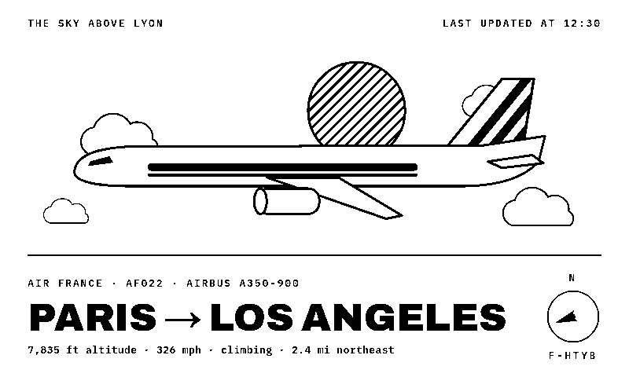
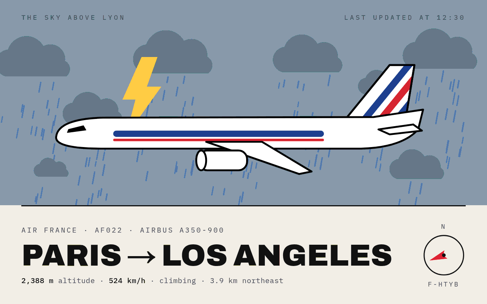
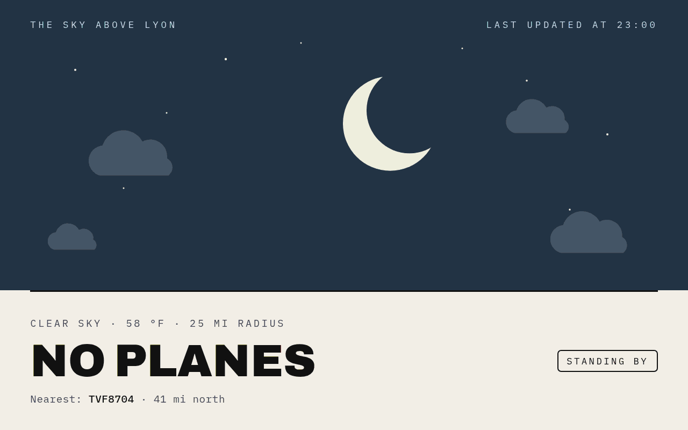
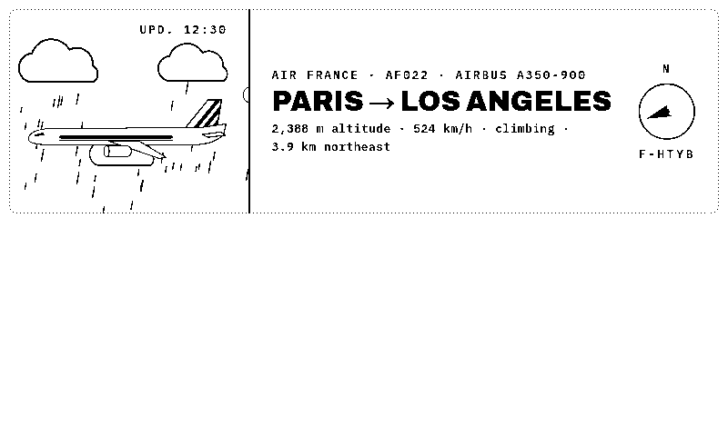
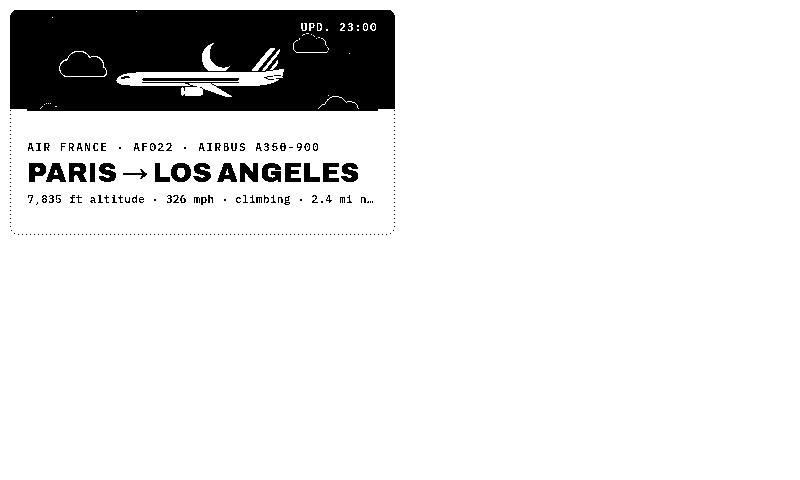
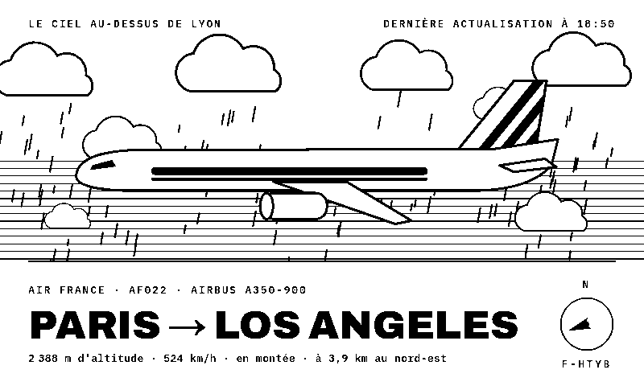
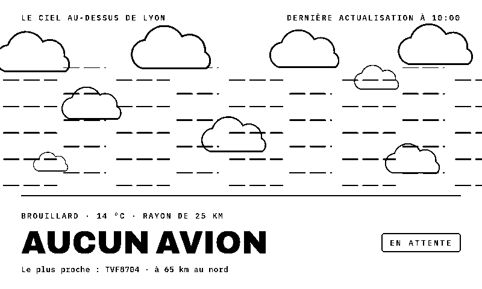
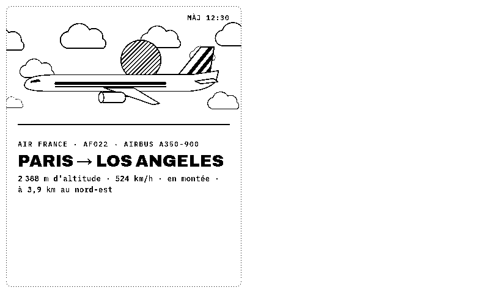

# FlightPoster

**[English](#english) · [Français](#français)**

---

## English

*Look up: FlightPoster tells you which plane is flying over your home.*

A TRMNL plugin that shows the plane flying over your home, with the real sky behind it: sun, dusk or night, and the current weather (clouds, rain, snow, fog, thunderstorms).

No server to install. Everything comes from free, community-run data sources:

| Data | Source |
|---|---|
| Live aircraft positions | [adsb.fi](https://adsb.fi) open data |
| Routes, airlines, aircraft | [adsbdb](https://www.adsbdb.com), with [VRS standing data](https://github.com/vradarserver/standing-data) (via adsb.lol) as a fallback |
| Weather | [Open-Meteo](https://open-meteo.com) (CC BY 4.0) |

### Features

- **E-ink and color**: a pure black & white style built for 1-bit screens (TRMNL OG, TRMNL X), and a color style for LCD screens
- **Every layout**: full screen, half horizontal, half vertical and quadrant (mashups)
- **Real sky**: day, dusk or night from the sun's position, plus the current weather
- **Empty sky**: when no plane is overhead, shows the weather, the temperature and the nearest plane outside your radius
- **English or French**, **metric or imperial** units
- Flights without a published route (private, business, military) show their operator or aircraft type instead

### Screenshots

| | |
|---|---|
|  |  |
| E-ink · clear day · imperial units | Color · thunderstorm |
|  |  |
| TRMNL X · snowy night | Color · no plane overhead |
|  |  |
| Half horizontal · rain | Quadrant · night |

### Installation

**TRMNL (usetrmnl.com)**: create a *Private Plugin* with the *Polling* strategy, then copy:
- both URLs from `polling_url` in `src/settings.yml` (one per line) into *Polling URL*;
- the `custom_fields` from `src/settings.yml` into *Custom fields* (YAML);
- `src/shared.liquid` into *Shared markup*, and each `src/<layout>.liquid` into the matching layout tab.

The `src/` folder follows the [trmnlp](https://github.com/usetrmnl/trmnlp) layout.

**LaraPaper / BYOS**: *Plugins → Import recipe*, pick `flightposter.zip`, then fill in your settings.

### Settings

| Field | Purpose |
|---|---|
| Latitude / Longitude | Your home's position |
| Display name | Shown in "The sky above …" (defaults to "home") |
| Language | English or French |
| Units | Metric (m, km/h, °C) or imperial (ft, mph, °F) |
| Radius | How close a plane must be to count as overhead, in km or miles (default 25) |
| Prefer airliners | Ignore light aircraft when an airliner is within the radius |
| Style | E-ink (black & white) or Color |

### Notes

- The screen is built with JavaScript at render time, so the renderer must run JavaScript.
- Route lookups happen at render time. If adsbdb doesn't answer, the plane still shows with its callsign.
- The data sources are free community services: please keep the refresh interval reasonable (5 minutes or more).

---

## Français

*Levez les yeux : FlightPoster vous dit quel avion survole votre maison.*

Un plugin TRMNL qui affiche l'avion qui passe au-dessus de chez vous, avec le vrai ciel derrière : soleil, crépuscule ou nuit, et la météo du moment (nuages, pluie, neige, brouillard, orage).

Aucun serveur à installer. Toutes les données viennent de services gratuits et communautaires :

| Données | Source |
|---|---|
| Positions des avions en direct | données ouvertes [adsb.fi](https://adsb.fi) |
| Itinéraires, compagnies, appareils | [adsbdb](https://www.adsbdb.com), avec la base [VRS standing data](https://github.com/vradarserver/standing-data) (via adsb.lol) en secours |
| Météo | [Open-Meteo](https://open-meteo.com) (CC BY 4.0) |

### Fonctionnalités

- **E-ink et couleur** : un style noir et blanc pensé pour les écrans 1 bit (TRMNL OG, TRMNL X), et un style couleur pour les écrans LCD
- **Tous les formats** : plein écran, demi horizontal, demi vertical et quart d'écran (mashups)
- **Le vrai ciel** : jour, crépuscule ou nuit selon la position du soleil, et la météo actuelle
- **Ciel vide** : quand aucun avion ne passe, affiche la météo, la température et l'avion le plus proche hors du rayon
- **Français ou anglais**, unités **métriques ou impériales**
- Les vols sans itinéraire publié (privés, d'affaires, militaires) affichent leur opérateur ou leur modèle d'avion

### Captures

| | |
|---|---|
|  |  |
| Couleur · éclaircies | E-ink · crépuscule sous la pluie |
|  |  |
| E-ink · brouillard, aucun avion | Demi vertical |

### Installation

**TRMNL (usetrmnl.com)** : créer un *Private Plugin* en stratégie *Polling*, puis recopier :
- les deux URL de `polling_url` dans `src/settings.yml` (une par ligne) dans *Polling URL* ;
- les `custom_fields` de `src/settings.yml` dans *Custom fields* (YAML) ;
- `src/shared.liquid` dans *Shared markup*, et chaque `src/<format>.liquid` dans l'onglet du format correspondant.

Le dossier `src/` suit l'organisation de [trmnlp](https://github.com/usetrmnl/trmnlp).

**LaraPaper / BYOS** : *Plugins → Import recipe*, choisir `flightposter.zip`, puis renseigner les réglages.

### Réglages

| Champ | Rôle |
|---|---|
| Latitude / Longitude | Position de votre domicile |
| Nom affiché | Affiché dans « Le ciel au-dessus de … » (par défaut « chez moi ») |
| Langue | Anglais ou français |
| Unités | Métriques (m, km/h, °C) ou impériales (ft, mph, °F) |
| Rayon | Distance maximale pour qu'un avion soit « au-dessus », en km ou en miles (25 par défaut) |
| Avions de ligne en priorité | Ignore l'aviation légère quand un avion de ligne est dans le rayon |
| Style | E-ink (noir et blanc) ou Couleur |

### Remarques

- L'affichage est construit en JavaScript au moment du rendu : le moteur de rendu doit exécuter le JavaScript.
- Les itinéraires sont récupérés au moment du rendu. Si adsbdb ne répond pas, l'avion s'affiche quand même avec son indicatif.
- Les sources de données sont des services communautaires gratuits : merci de garder un intervalle de rafraîchissement raisonnable (5 minutes ou plus).

*Les captures sont réalisées sur Lyon, avec des données de démonstration.*
